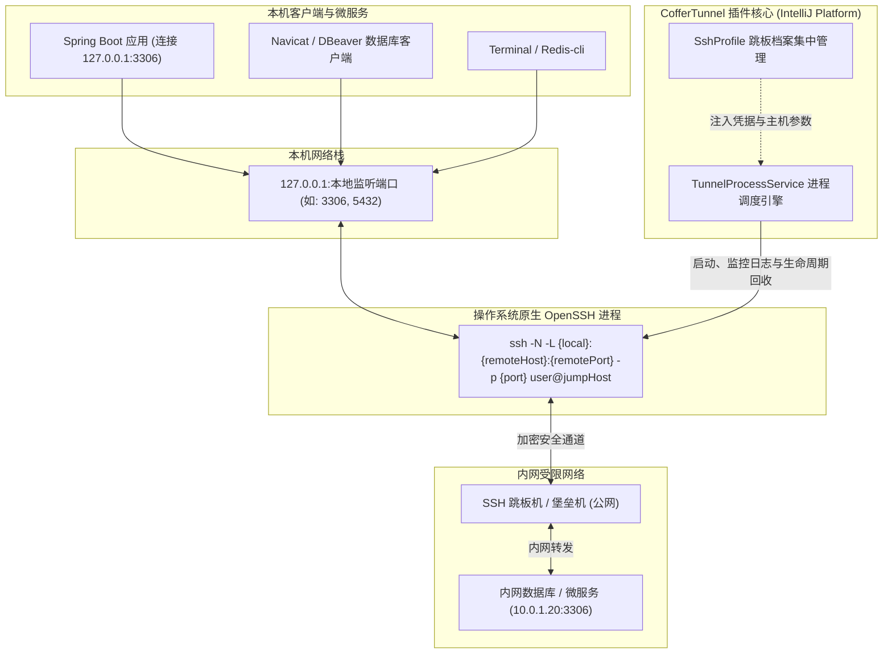

@[TOC](目录)

# 别再手动敲 ssh -L 了！开源神器 CofferTunnel：让 IDEA 一键打通内网数据库，SpringBoot 直接连！

---

> **项目名称**：CofferTunnel  
> **Plugin ID**：`tech.coffers.tunnel`  
> **开源地址**：[https://github.com/coffersTech/coffer-tunnel](https://github.com/coffersTech/coffer-tunnel)  
> **技术栈**：Kotlin, IntelliJ Platform SDK, OpenSSH, Swing  
> **适用环境**：IntelliJ IDEA 2023.1 ~ 2024.1+（社区版 IC / 专业版 IU 全线兼容）

---

## 一、后端研发的日常之痛：内网数据库穿透

作为后端开发者，你一定对以下场景感同身受：

公司出于安全合规要求，生产、预发甚至测试环境的数据库（PostgreSQL、MySQL、Redis、MongoDB）都严禁暴露公网 IP，只能通过一台配置了严格密钥认证的 **SSH 跳板机（Bastion / Jump Host）** 才能访问。

于是，每天上班的第一件事就是打开终端敲命令：
```bash
ssh -N -L 3306:10.0.1.20:3306 -i ~/.ssh/id_rsa -p 22 deploy@jump.yourcompany.com
```

如果业务系统微服务比较多，需要同时连 5 个库：
- 用户中心 MySQL：`3306 -> 10.0.1.20:3306`
- 订单中心 PostgreSQL：`5432 -> 10.0.1.25:5432`
- 缓存 Redis：`6379 -> 10.0.1.30:6379`
- 报表库：`3307 -> 10.0.1.40:3306`
- 消息队列管理：`15672 -> 10.0.1.50:15672`

你得在终端里开 5 个 Tab，或者用后台模式跑一堆进程。接着各种抓狂的问题接踵而至：
1. **终端误关即断开**：笔记本合盖或者终端窗口不小心关了，端口转发瞬间掐断，本地正在断点调试的 Spring Boot 应用直接抛出 `HikariCP - Connection timeout`；
2. **僵尸进程霸占端口**：有时网络闪断，后台的 ssh 进程还卡着端口，再次启动直接报错 `bind [127.0.0.1]:3306: Address already in use`，不得不掏出 `lsof -i :3306` 然后 `kill -9`；
3. **重复配置冗余**：同一个跳板机连 5 个服务，就要把跳板机 Host、用户名、私钥文件路径重复填 5 遍。

---

## 二、为什么现有的方案都“差强人意”？

很多同学会问：“IDEA 自带的 Database 工具不是可以配 SSH 隧道吗？”

**这就是最大的痛点所在！**
- **局限性**：IDEA 自带 Database 插件的 SSH 隧道仅限其**内部可视化查询窗口**可用；
- **无法系统级暴露**：本机正在启动调试的 Spring Boot 工程、第三方的 Navicat、DBeaver、或者在终端敲的 `curl` / `redis-cli`，**根本无法访问该端口**！

市面上虽然有一些独立的 SSH 桌面 GUI 工具，但它们要么体积庞大臃肿，要么配置复杂，开发时必须在 IDE 和外部客户端之间频繁切屏。

我们需要的是一个：
> **直接内嵌在 IDEA 侧边栏、调用操作系统原生底层 OpenSSH 建立真正的系统级端口监听、跳板机凭据可无限复用、关机/关 IDE 自动安全回收子进程** 的轻量级利器！

这就是 **CofferTunnel** 诞生的初衷。

---

## 三、核心原理：CofferTunnel 的架构与第一性原理

CofferTunnel 不重新造轮子实现私有的 SSH 协议，也不反射调用任何 IDEA Database 的私有内部 API：



### 为什么选择 `ssh -N` 而不是 `-fN`？
在常规脚本中，大家习惯加上 `-f` 让 ssh 转入后台。但从 Java 进程管理的第一性原理来看：
- `-f` 会导致主命令 fork 之后原进程立即退出，Java 的 `Process` 句柄在几毫秒内就检测到终止，从而彻底丢失对后台进程的 PID 和生命周期控制权，既无法实时捕获 stderr/stdout 错误，也无法在点击【停止】时精准销毁。
- **CofferTunnel 采用 `ssh -N`（配合保活参数）**，由插件全局应用服务持久持有真实子进程句柄。不仅能实时将跳板机的报错输出到控制台面板，更能随时调用 `process.destroy()` 精准停止。

---

## 四、核心特性图文全景实战

### 1. 优雅的原生卡片式 ToolWindow 与独立控制台

打开 IDEA 右侧侧边栏的 **CofferTunnel**，即可看到极其简洁的原生界面：

> 💡 **插图位置**：在此处粘贴插件主面板截图（ToolWindow 主界面）

- **告别传统表格**：采用分层的卡片式 `JBList`，第一层是醒目的状态圆点与主标题，第二层是清晰的链路流向：`127.0.0.1:本地端口 ➔ 跳板档案 ➔ 远端主机:目标端口`；
- **纯正 AllIcons**：顶部动作栏全量使用 JetBrains 内置官方图标，未选中任何隧道时自动置灰禁用；
- **可折叠独立控制台**：下方内嵌折叠式控制台，支持自动滚动与一键清空日志，实时输出该隧道的 OpenSSH 完整运行流。

---

### 2. 跳板档案 (SshProfile) 与隧道解耦复用

在实际生产开发中，一个团队往往共用同一个堡垒机跳板，只是映射的内网服务 IP 和端口不同。CofferTunnel 引入了**跳板档案 (SshProfile)** 解耦机制：

点击工具栏的【跳板档案】按钮，即可唤起集中管理面板：

> 💡 **插图位置**：在此处粘贴【SSH 跳板档案管理】弹窗截图

- **一次配置，全量复用**：在这里维护跳板名称、Host、SSH 端口、用户名、私钥文件路径及额外参数；
- **即时连通性测试**：点击【测试连通性】，系统在后台执行毫秒级 Socket 握手探测，无需真正建立隧道即可立刻获知网络响应时延（如 `连接成功！耗时: 35ms`）；
- **安全防误删约束**：删除跳板档案时会自动校验引用，若当前正被业务隧道使用，系统会直接拦截并明确列出关联隧道名称，绝无配置丢失隐患。

---

### 3. 目标服务联动与本地端口防冲突检测

点击工具栏的 `+` 新建隧道，弹出清爽的配置表单：

> 💡 **插图位置**：在此处粘贴【新建 SSH 隧道】表单截图

这里包含了大量贴心的开发者体验细节：
1. **跳板档案下拉 + 快捷新建**：直接下拉选择刚才配置的跳板机；若还没配置，点击右侧 `[+ 新建跳板]` 即可秒级录入；
2. **目标服务预设端口**：
   - 切换为 **MySQL/MariaDB**：远端端口自动回填 `3306`；
   - 切换为 **PostgreSQL**：远端端口自动回填 `5432`；
   - 切换为 **Redis**：远端端口自动回填 `6379`；
   - 切换为 **MongoDB**：远端端口自动回填 `27017`；
   - 切换为 **自定义**：自动清空由用户自由输入（支持随时手动覆盖默认值）；
3. **本地监听端口占用实时检测**：
   - 输入框右侧内置 `[检测占用]` 按钮；
   - 支持**焦点离开自动感知**：输入端口切出光标后，自动探测该端口是否已被宿主机其他进程霸占，并给出绿色可用或红色占用告警；
   - 表单提交时更带有智能警告保护，杜绝盲目启动导致的端口冲突。

---

### 4. 双语一键热切与平台主题动态自适应

许多国内开发者的 IDEA 虽然配置为英文主界面，但在插件使用上可能更偏爱中文，反之亦然。

- **多语言独立切换**：工具栏右上角提供 `Lang` 下拉菜单，支持 **跟随系统 (Auto)**、**简体中文** 与 **English** 一键热切，毫秒级就地重绘所有界面文本，无需重启 IDE；
- **全平台动态调色板**：代码中严禁任何硬编码 RGB 颜色，全部调用 IntelliJ `UIUtil` 与 `JBColor`，无论是经典的 Darcula 暗色模式、IntelliJ Light 浅色模式，还是 JetBrains 最新的 New UI，均能完美融合。

---

## 五、安全合规与防僵尸进程设计

作为一款面向企业的开发工具，**安全性**是第一红线：

1. **零数据外传**：插件杜绝任何网络上报、分析埋点逻辑。所有连接配置仅保存在本地 IDE 的 `options/coffer_tunnel.xml` 中；
2. **兼容 ssh-agent 与 Passphrase**：子进程完整继承宿主机的环境变量（包含 `SSH_AUTH_SOCK`），支持带口令保护的私钥通过 ssh-agent 免密静默授权；
3. **双重防僵尸进程防护**：
   - `TunnelProcessService` 作为应用级全局单例，实现 `Disposable` 接口；
   - 注册 `AppLifecycleListener` 深度监听 IDE 退出事件（`appWillBeClosed`）；
   - 在 IDE 关闭或重启的瞬间，自动遍历所有运行中的子进程，先执行优雅 `destroy()`，超时未退出强制 `destroyForcibly()`，**彻底释放本地所有监听端口，告别端口霸占**！

---

## 六、30 秒快速上手体验

### 方式 1：本地构建与安装
确保机器环境具备 JDK 17+：
```bash
# 克隆仓库
git clone https://github.com/coffersTech/coffer-tunnel.git
cd coffer-tunnel

# 编译打包插件
./gradlew buildPlugin
```
构建成功后，在 `build/distributions/CofferTunnel-1.0.0.zip` 即可获得离线安装包。

打开 IntelliJ IDEA -> `Settings` -> `Plugins` -> 右上角齿轮 ⚙️ -> `Install Plugin from Disk...`，选择该 zip 即可完成安装！

### 方式 2：沙盒实时热启动调试
如果你想直接体验或二次开发扩展功能：
```bash
./gradlew runIde
```
命令执行完毕后，屏幕上会自动弹出一个全新的独立 IDEA 沙盒窗口，右侧边栏已就绪 **CofferTunnel**！

---

## 七、写在最后

开发 CofferTunnel 的核心理念就是 **KISS（Keep It Simple, Stupid）**：
不搞复杂的远程同步，不写多余的重量级协议，只用最干净、最稳健的方式，帮后端开发者把最繁琐的端口转发管理好。

如果这个工具也解决了你在日常开发中的内网调试痛点，欢迎在 GitHub 上给个 ⭐️ **Star** 支持一下！如果有任何功能建议或遇到了特殊场景，欢迎在 Issue 中共同讨论。

- **GitHub 源码仓库**：[https://github.com/coffersTech/coffer-tunnel](https://github.com/coffersTech/coffer-tunnel)
- **开源协议**：Apache-2.0
- **作者**：coffersTech
